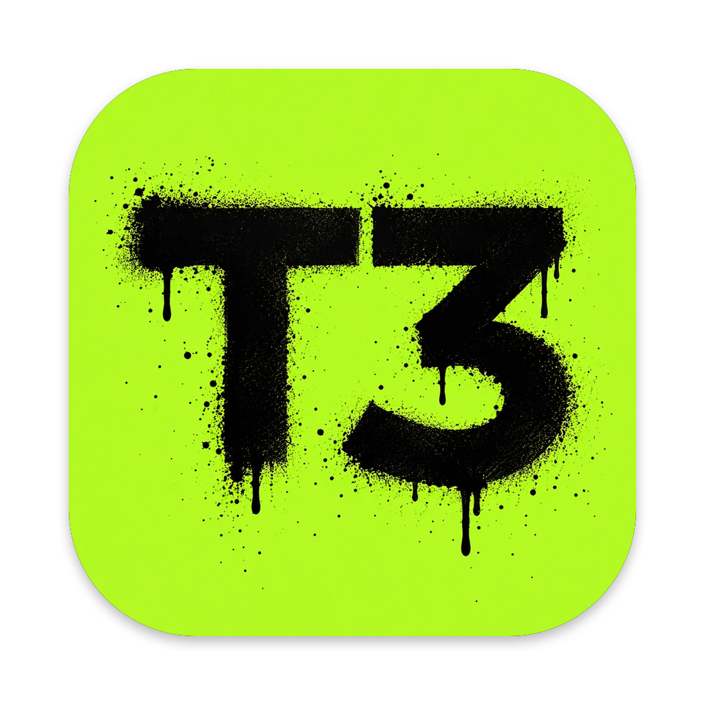

<p align="center">
  <a href="https://t3remix.com">
    
  </a>
</p>

<h1 align="center">T3 Remix</h1>

<p align="center">Run your agents like a company.</p>

<p align="center">
  <a href="https://github.com/codingphasedotcom/t3-remix/releases/latest"><strong>Download</strong></a> ·
  <a href="https://t3remix.com">Website</a> ·
  <a href="https://t3remix.com/docs/">Docs</a> ·
  <a href="https://t3remix.com/docs/devlog/">Dev log</a> ·
  <a href="https://github.com/codingphasedotcom/t3-remix/issues">Issues</a>
</p>

T3 Remix is an open-source fork of [T3 Code](https://github.com/pingdotgg/t3code) that turns your coding agents into a company: a CEO, an org chart, and a board where agents plan, build, review, and ship your tasks.

You give the CEO a task. The CEO plans it, hands the work to its employees, reviews what they deliver, and hands the finished task back to you. Agents coordinate only through the board, never by messaging each other, so every assignment, question, and review is written down where you can read it.

## What T3 Remix adds

- **Companies.** A CEO, a mission, a home project, and a board. Start from a software team template, let the CEO recommend a team, or start with just a CEO.
- **Org chart.** Employees with roles, departments, managers, skills, models, and faces. Agents ask you before anyone new is hired.
- **The board.** Six columns from Ideas to Done. Tasks with an assignee start on their own, and managers review their team's work.
- **Comments and mentions.** Comment on a task and its owner answers. Mention an employee with `@CTO` from any chat.
- **Shipping.** Each task works on its own branch. Open a pull request, or let the agent merge it and fix any conflicts.
- **Memory and skills.** Lessons that survive between tasks, and reusable playbooks, including the skills your agents already have installed.
- **Routines.** Tasks that add themselves on a schedule.
- **Inbox, timeline, and dashboard.** Everything waiting on you in one place, a timeline of tasks and commits, and monthly token budgets with throughput, run success, and spend.
- **Portable companies.** Export a company to a file and import it on any computer running T3 Remix.

## What stays the same

Everything below the board is T3 Code. Agents run through the providers you already use: Claude Code, Codex, Cursor, OpenCode, Grok Build, Antigravity, Kiro, Pi, Muse Code, fx, and any [ACP](./docs/user/providers-acp.md) agent. Each board run is an ordinary thread you can open and read, and every turn ends with a checkpoint you can diff and restore.

- **Your subscriptions.** T3 Remix does not resell tokens. It drives the agents you are already signed in to.
- **Every agent in one place.** Each employee picks its own model, so one company can mix providers.
- **Git built in.** Each task can work in its own worktree. Review the diff, then open a pull request or merge.
- **Remote ready.** Run agents on any machine and connect over your local network, Tailscale, or [T3 Connect](./docs/user/remote-access.md).
- **Open.** MIT licensed, like T3 Code.

Companies are available in the desktop app and the web app. The mobile app does not show companies yet.

## Install

Download the installer for your computer from the [latest release](https://github.com/codingphasedotcom/t3-remix/releases/latest). Its file name ends in:

| Computer                    | File                    |
| --------------------------- | ----------------------- |
| Mac with Apple silicon      | `mac-arm64.dmg`         |
| Mac with an Intel processor | `mac-x64.dmg`           |
| Windows, 64-bit             | `windows-x64-setup.exe` |
| Linux, 64-bit               | `linux-x86_64.AppImage` |

Release builds are not signed, so your computer warns you the first time you open one. On macOS, choose **Open Anyway** in **System Settings** > **Privacy & Security**, or clear the quarantine flag:

```bash
xattr -dr com.apple.quarantine "/Applications/T3 Remix.app"
```

On Windows, choose **More info**, then **Run anyway** when SmartScreen warns you. [Install](https://t3remix.com/docs/install/) has the steps for every platform.

### Sign in to an agent

T3 Remix needs one agent that is installed and signed in. For example, install [Claude Code](https://claude.com/product/claude-code) and run `claude auth login`, or install [Codex CLI](https://developers.openai.com/codex/cli) and run `codex login`. Then follow [Your first company](https://t3remix.com/docs/quickstart/).

### Running beside T3 Code

T3 Remix is its own app. It installs beside T3 Code instead of replacing it:

- T3 Remix keeps its data in `~/.t3-remix`. T3 Code keeps its data in `~/.t3`. Neither touches the other's database.
- T3 Remix has no automatic update feed, so a T3 Code release never replaces it. To update, download a newer T3 Remix release. Your companies, boards, and threads carry over.

## Build from source

T3 Remix uses [Vite+](https://viteplus.dev). Install the global `vp` command, then clone and install:

```bash
curl -fsSL https://vite.plus | bash
```

```bash
git clone https://github.com/codingphasedotcom/t3-remix.git
cd t3-remix
vp i
```

Run `vp run dev` to start the server and the web app, or `vp run dev:desktop` for the desktop app. To build the Mac app as T3 Remix, run `vp run dist:desktop:remix`.

[Build from source](https://t3remix.com/docs/build-from-source/) covers Windows and Linux builds, releases, and giving your own fork its own identity. The [development runbook](./docs/operations/development.md#first-checkout) and [architecture overview](./docs/internals/overview.md) explain how the code works.

## Documentation

- [Introduction](https://t3remix.com/docs/)
- [Install](https://t3remix.com/docs/install/)
- [Your first company](https://t3remix.com/docs/quickstart/)
- [The board](https://t3remix.com/docs/board/)
- [Agent tools](https://t3remix.com/docs/agent-tools/)
- [Dev log](https://t3remix.com/docs/devlog/)

T3 Code's own guides, such as [remote access](./docs/user/remote-access.md), [permission modes](./docs/user/permission-modes.md), and [source control](./docs/user/source-control.md), also apply to T3 Remix. [All docs](./docs/README.md) has the full list.

## Staying current with T3 Code

T3 Remix merges T3 Code's `main` branch regularly and keeps every Remix feature through each merge. Each entry in the [dev log](https://t3remix.com/docs/devlog/) says which T3 Code release it is built on.

## Contributing

Report bugs and ideas for companies, the board, and other Remix features in [Issues](https://github.com/codingphasedotcom/t3-remix/issues). If a bug also happens in T3 Code itself, report it to [T3 Code](https://github.com/pingdotgg/t3code) so everyone gets the fix.

## Thanks

Big thanks to [Theo](https://x.com/theo) and the [T3 Code](https://t3.codes) team, and to [@Dotta](https://x.com/dotta), for the inspiration. T3 Remix stands on T3 Code's open-source work and would not exist without it.

## License

[MIT](./LICENSE). T3 Code is made by T3 Tools Inc. and is also MIT licensed. T3 Remix is an independent fork by [CodingPhase](https://codingphase.com).
